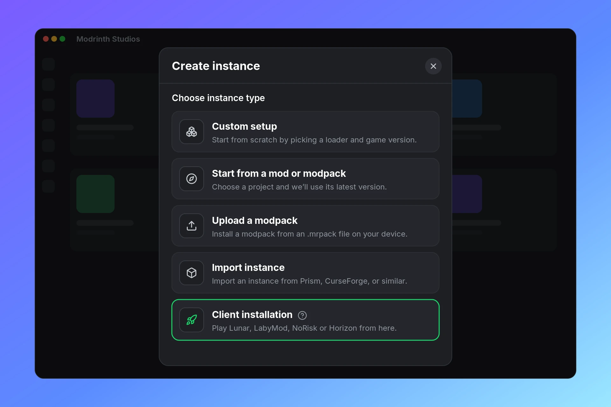
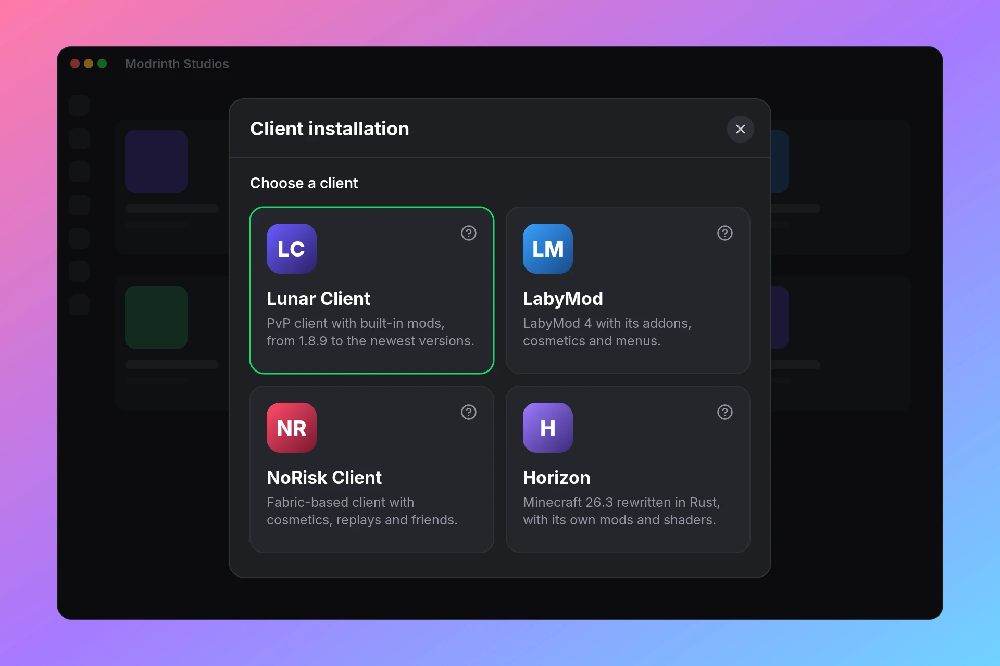
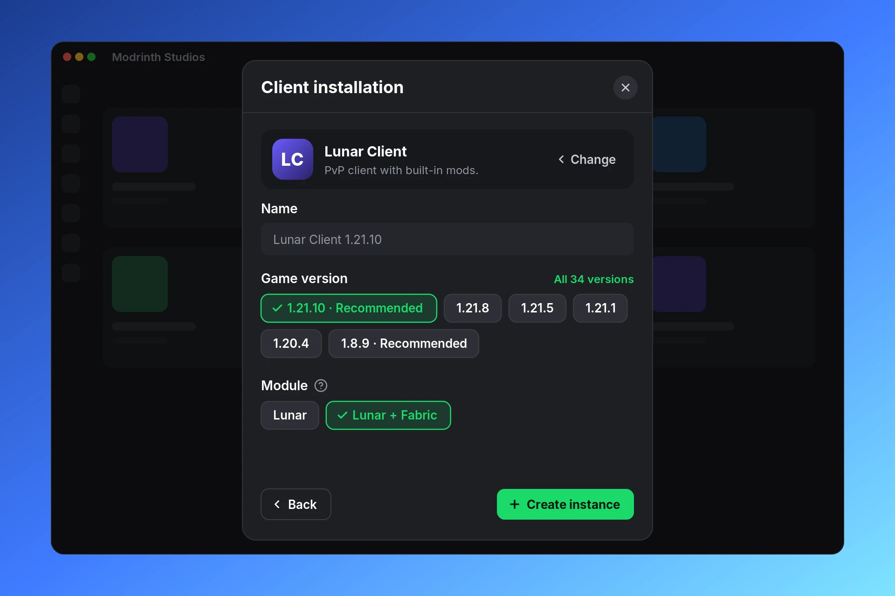
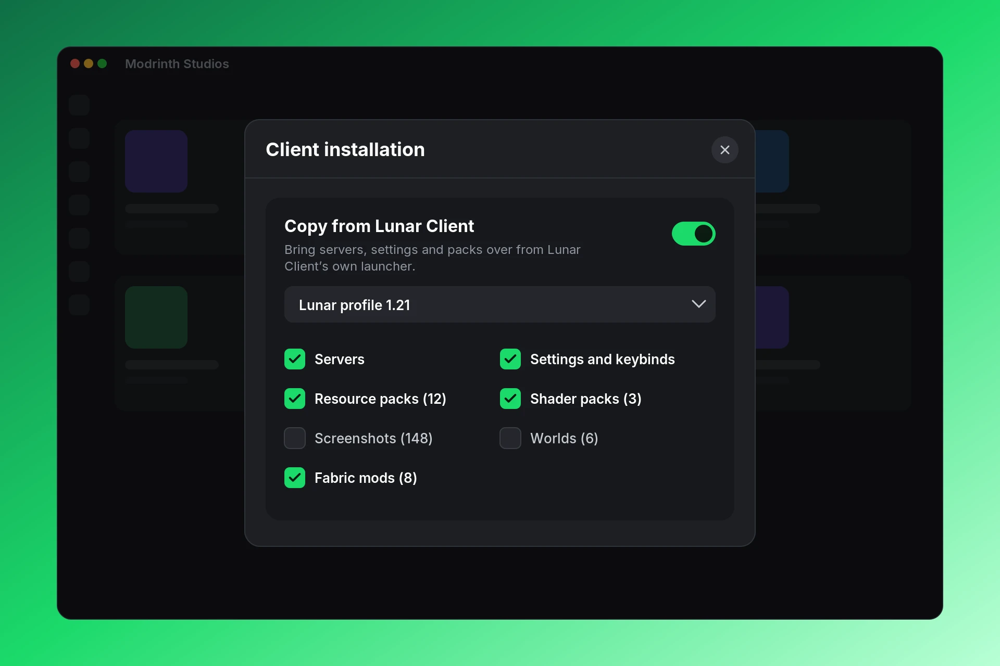
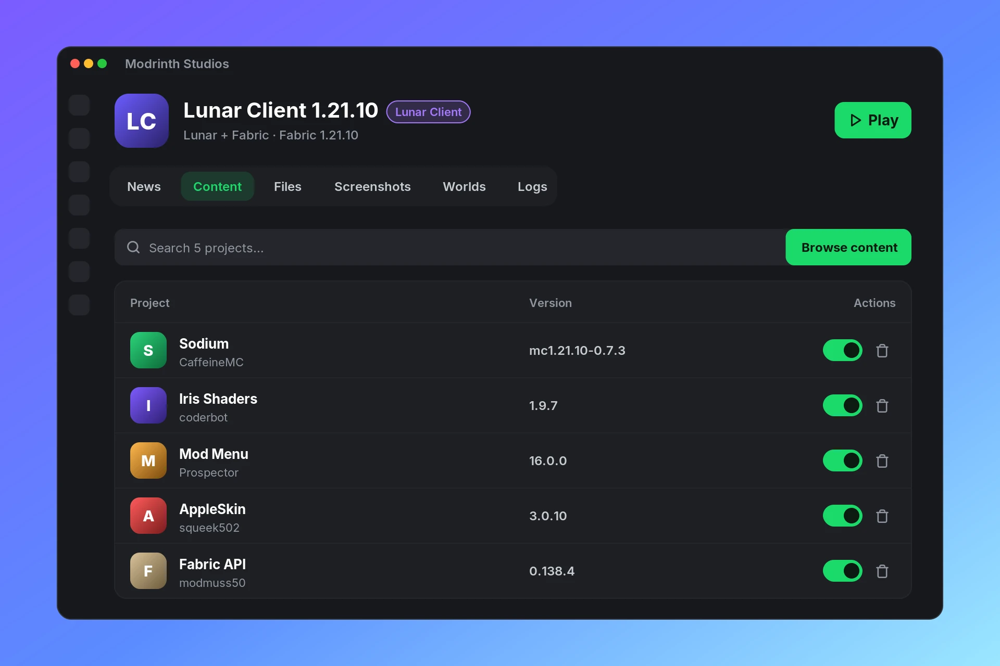

Hey everyone,

This is the biggest Modrinth Studios update so far. You can now play **Lunar Client**, **LabyMod**, **NoRisk Client** and **Horizon** straight from the app: no extra launchers, no juggling folders. They install like any other instance, show up in your library, and each one gets its own pages for news, content and more.

### TL;DR

- Install Lunar Client, LabyMod, NoRisk Client or Horizon from **Create instance → Client installation**
- Run Modrinth mods next to Lunar (Fabric and Forge) and NoRisk
- Copy your servers, settings, resource packs and mods over from the client's own launcher
- Every client gets its own tabs: news, content, capes, a Horizon home page and patch notes
- A new **Client** tab in instance settings for builds, modules, packs and updates

## Creating a client installation

Open **Create instance** and pick the new **Client installation** option.

Choose the client you want to play. Hover the **?** next to a client for a quick note on what to expect.

Then pick a version. The versions most people play are right there, with the recommended one marked, and **All versions** opens a searchable list, so finding 1.8.9 takes a second. Depending on the client you can also choose:

- **Lunar Client**: the module, like Lunar, Lunar + OptiFine, Lunar + Fabric or Lunar + Forge
- **NoRisk Client**: which NoRisk pack to play
- **LabyMod**: the release channel
- **Horizon**: Nightly, which updates itself, or a fixed build

Press **Create instance** and the client downloads in the background, right in the downloads menu at the top. You can also just press Play and anything missing is downloaded first.

## Bring your stuff over

Already play on one of these clients? Turn on **Copy from …** while creating the instance. Studios finds the client's own folders on your PC and copies:

- your **servers** and **settings and keybinds**
- **resource packs** and **shader packs**
- **Fabric or Forge mods**
- **screenshots** and **worlds**, if you want them

For Lunar it picks the profile for the version you chose, and sets the module that profile was played with, so a Fabric profile becomes a Lunar + Fabric instance. You can still change it before creating.

## It's a normal instance

Client installations sit in your library like everything else. They track playtime, keep their own worlds, screenshots and logs, and start from the Play button or Play mode. A tag next to the title shows which client an instance runs.

## Mods next to the client

**Lunar + Fabric**, **Lunar + Forge** and **NoRisk Client** keep the normal **Content** tab. Browse Modrinth like always and install whatever you want: Sodium, AppleSkin, Mod Menu, your favourite utility mods. They run next to the client's own features, and turning a mod off in the Content tab takes it out the next time you press Play.

In NoRisk instances, the pack's own mods sit in a **Modpack content** card at the top of the Content tab, with what you added yourself listed underneath.

## A page for each client

Each client gets tabs made for it.

### Lunar Client and LabyMod

Their latest news, right in the instance. Lunar's cosmetics, emotes and badges load in game too.

### NoRisk Client

News and a **Capes** page where you can browse NoRisk's capes, preview them on your skin in 3D and equip one. Sign in to NoRisk from the toolbar or the Client settings tab.

### Horizon

Horizon is Minecraft 26.3 rewritten in Rust, so it has its own registry of mods, resource packs and shaders instead of Java mods. Its **Home** tab shows the build you're on, what's popular in the registry and the latest patch notes. **Content** browses the registry with the same browse page you know from Modrinth, and **Patch notes** lists every build in a timeline. You play with your own Minecraft account, skin and cape included.

## Client settings

Instance settings have a new **Client** tab at the top. From there you can switch the build, module, pack or channel, check for updates, sign in to NoRisk, open Lunar's settings folder, and copy things over from the client's launcher at any time.

## Good to know

Client installations are new, and they're unofficial: none of these clients is made by us, and each one is launched the way its own launcher does it. That means a client can break for a while when it changes how it works, until Studios catches up. If something won't start, **Check for updates** in the Client settings tab fixes most problems. If it doesn't, let us know on GitHub.

A few things work a little differently than in the official launchers:

- Lunar Client: Fabric and Forge mods need the Lunar + Fabric or Lunar + Forge module
- LabyMod: addons come from LabyMod's own in-game store, not from Modrinth
- Horizon: chat on servers that require signed chat doesn't work in Horizon yet

Thanks for playing, and let us know what you think!
