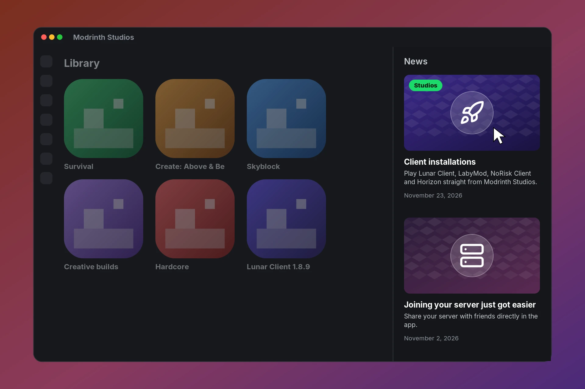
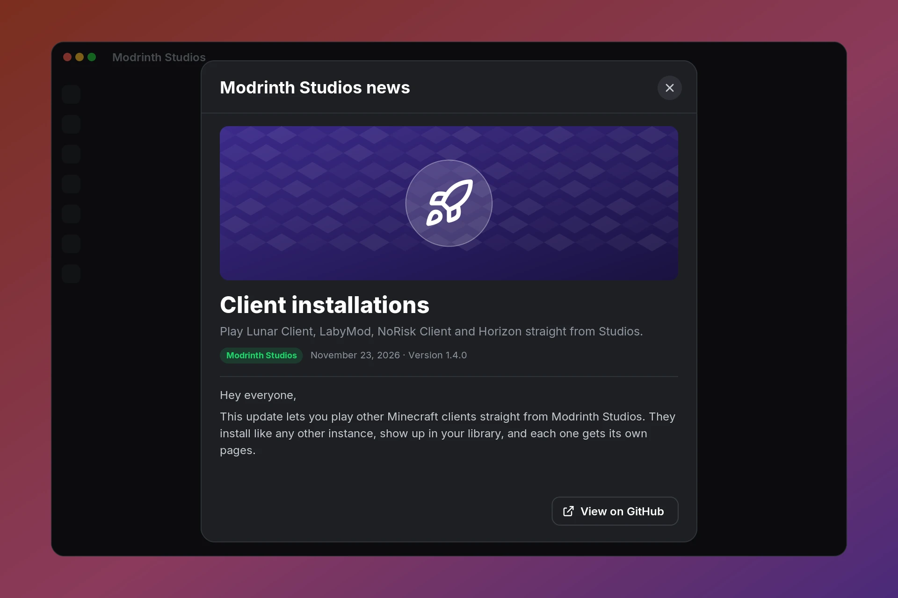

Hey everyone,

Modrinth Studios now has its own news. Updates to the launcher finally have a place inside the launcher: what changed, how it works, and where to find it.

### TL;DR

- Studios update articles show up next to Modrinth's news in the News panel
- Every article, Studios or Modrinth, opens right inside the app
- Articles can have images, videos and links
- Big updates introduce themselves once with a popup

## Updates, right where you play

Look for the green **Studios** badge on a news card. It marks an update about this app. Modrinth's own articles are still there too, in the same list.

Click any card to read the full article without leaving the launcher. The button at the bottom opens the original page if you'd rather read it in your browser.

## More than a changelog

These articles give new features room to breathe. Instead of a line saying something was added, we can explain what it does, show how it looks and walk through getting started.

Images and videos play inside the reader, for Modrinth's articles as well as ours.

## A heads-up for the big updates

Some releases come with an article that opens by itself the first time you start that version. Once you've seen it, it won't come back, but you can always find it again in News.

## Coming next

The next articles cover **Play mode** and **Client installations**, each with what you need to get started.
