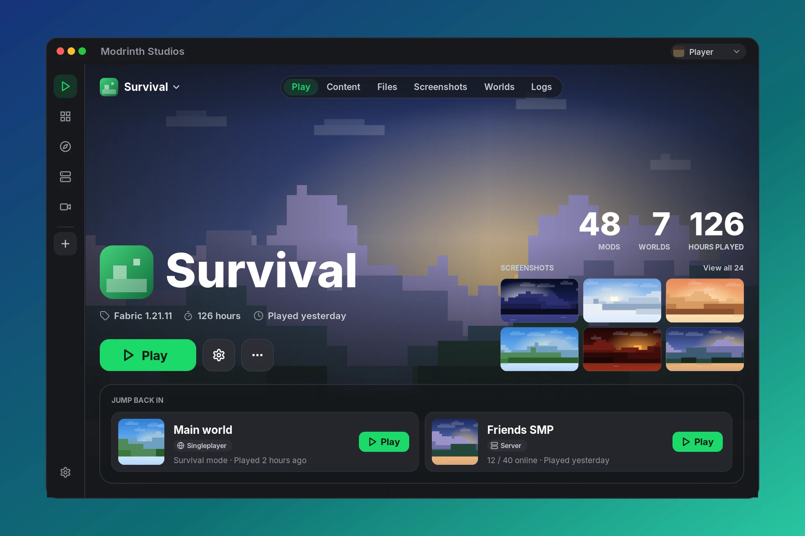
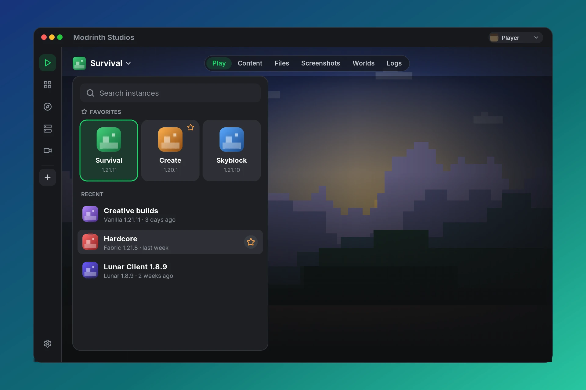

Hey everyone,

If you usually open the launcher to play the same instance, **Play mode** puts that instance front and centre. It's a home screen for your setup, with a big Play button, your screenshots in the background and your worlds close by.

### TL;DR

- Turn it on in **Settings → Features → Play mode** and pick an instance
- The sidebar's Play button opens that instance's Play screen
- Click the instance name at the top left to switch, and star the ones you play most
- Your library is still one click away, right under Play

## A home for your instance

The selected instance gets a full-screen page. Its name and Play button sit over your screenshots, with the instance's other tabs (content, files, screenshots, worlds and logs) at the top.

On the right you'll see how many mods and worlds it has and how long you've played, plus your latest screenshots. Along the bottom, **Jump back in** lists the worlds and servers you played last, each with its own Play button.

## Switching instances

Click the **instance name at the top left** to open the picker. Search by name or version, or pick from the list.

If you jump between two or three instances, **star them**. Starred instances stay at the top as big tiles, so switching is one click. Everything else is listed under **Recent**, sorted by when you last played it, with its loader and version.

Picking an instance opens its Play screen and makes it the one the sidebar's Play button opens. Switching doesn't stop a game that's already running.

## Your library is still there

Play mode only changes what the sidebar's Play button opens. Your other instances stay in the library, and the Library button sits right under Play.

You can turn Play mode off again in **Settings → Features** whenever you'd rather have the regular home screen.
